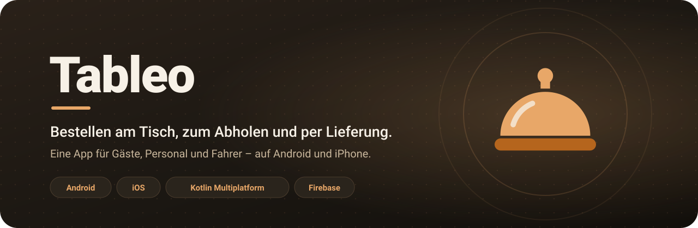
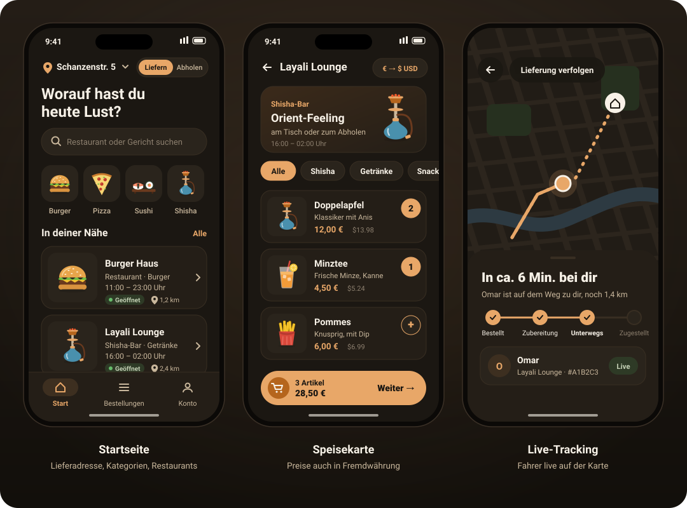
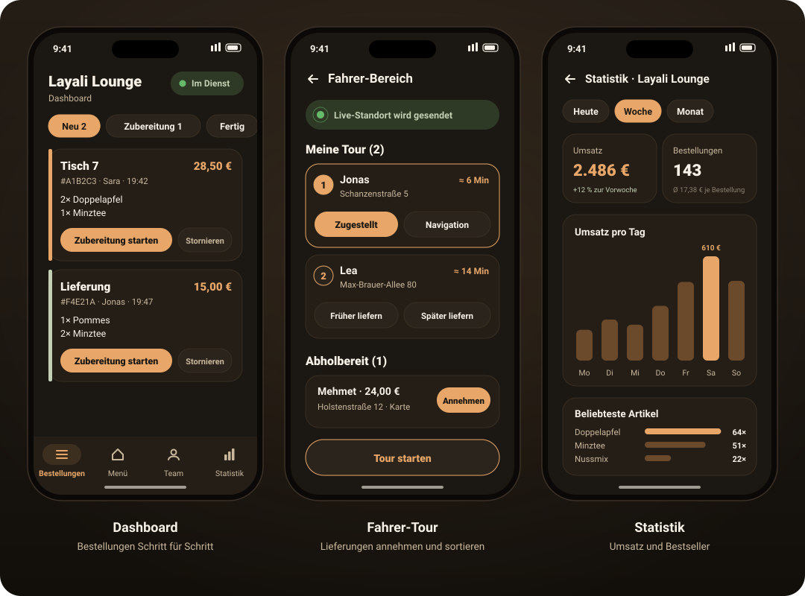
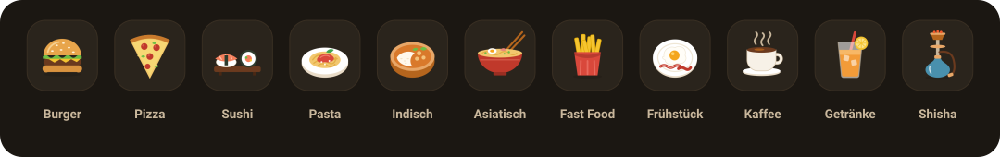
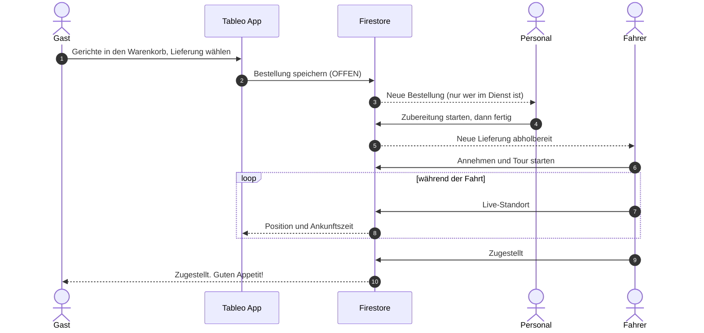
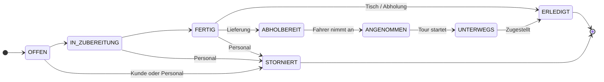
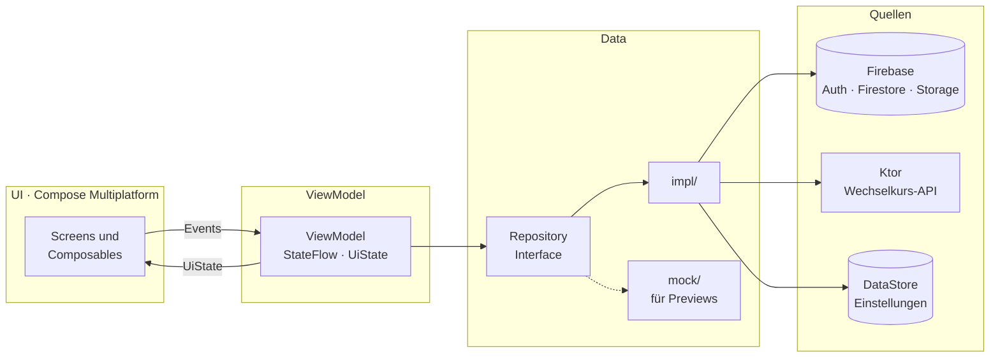

<div align="center">



<br/><br/>


**Eine App, drei Rollen, zwei Plattformen.**<br/>
Gäste bestellen am Tisch, zum Abholen oder per Lieferung. Das Personal arbeitet die Bestellungen im Dashboard ab,
und Fahrer liefern mit Live-Standort aus. Android und iPhone teilen sich dabei fast den gesamten Code.

[Einblicke](#-einblicke) · [Funktionen](#-funktionen) · [Bestellablauf](#-so-läuft-eine-bestellung) · [Architektur](#-architektur) · [Tech-Stack](#-tech-stack) · [Einrichtung](#-einrichtung)

</div>

---

## 📱 Einblicke

<p align="center">
  
</p>

<p align="center">
  
</p>

<p align="center"><sub>Illustrationen im Design der App (Dunkelmodus). Echte Screenshots folgen.</sub></p>

---

## ✨ Funktionen

<table>
<tr>
<td width="33%" valign="top">

### 🍽️ Gäste und Kunden

- Lieferadresse und **Lieferung / Abholung** oben auf der Startseite, beides bleibt gespeichert
- Bei Lieferung nur Restaurants, die liefern
- Suche, Kategorien mit Bildern, Filter nach Art
- Speisekarte mit Preisen in **Fremdwährung** (Wechselkurs-API)
- Bestellen **am Tisch**, **zur Abholung** mit Uhrzeit oder als **Lieferung**
- Bestellungen mit **Live-Status**, Erneut bestellen, Stornieren
- **Live-Tracking** des Fahrers mit Ankunftszeit
- Benachrichtigung bei jedem neuen Schritt

</td>
<td width="33%" valign="top">

### 👨‍🍳 Personal

- Registrierung mit **Restaurant-ID**, danach direkt ins Dashboard
- Bestellungen weiterschalten:<br/>Neu → Zubereitung → Fertig → Erledigt
- Schalter **„Im Dienst“**: nur dann kommen Nachrichten zu neuen Bestellungen
- Speisekarte mit Fotos verwalten
- **Archiv** und **Statistik** mit Diagramm
- **Team** mit Profilbild, Rolle und Dienst-Status, die Leitung vergibt Rollen

</td>
<td width="33%" valign="top">

### 🛵 Fahrer

- Registrierung als Fahrer, danach direkt in den Fahrer-Bereich
- Abholbereite Lieferungen **annehmen**
- Eigene **Tour** sortieren: früher oder später liefern
- **Live-Standort** geht an die Kunden
- Kunden sehen, wie viele Stopps noch vor ihnen liegen

</td>
</tr>
</table>

**Für alle:** 10 Sprachen inkl. Arabisch von rechts nach links · Hell- und Dunkelmodus · Konto mit Profilbild ·
Konto löschen mit 30 Tagen Frist · Impressum, Datenschutz und AGB in der App

### Kategorien

<p align="center">
  
</p>

---

## 🔄 So läuft eine Bestellung



<details>
<summary><b>Alle Status einer Bestellung</b></summary>

<br/>



Der Kunde kann stornieren, solange die Bestellung noch offen ist. Das Personal kann stornieren, bis der Fahrer losgefahren ist.

</details>

---

## 🏛️ Architektur

Tableo ist nach **MVVM mit Repository Pattern** aufgebaut. Fast der ganze Code liegt in `shared/commonMain`
und läuft unverändert auf Android und iOS.



- Screens holen ihr ViewModel per `koinViewModel()`, Previews bauen es mit den **Mock-Repositories**
- ViewModels sprechen nur mit Repositories, nie direkt mit Firebase oder Ktor
- Was nur auf einer Plattform geht, steht als `expect` in commonMain und als `actual` in androidMain bzw. iosMain
  (Karte, Standort, Benachrichtigungen, Fotoauswahl, Sprache)
- Navigation mit **typisierten Routen** (`@Serializable`), keine String-Navigation

| | Android | iOS |
|---|---|---|
| Karte | Google Maps | Apple Maps (MapKit) |
| Standort | FusedLocationProvider | CoreLocation |
| Benachrichtigungen | NotificationManager | UserNotifications |
| Fotoauswahl | Photo Picker | PHPicker |
| Einstieg | `MainActivity` | `MainViewController` |

<details>
<summary><b>Projektstruktur</b></summary>

```
Tableo-KMP/
├── androidApp/                 Android-App: MainActivity, Koin-Start, Manifest, Icons
├── iosApp/                     Xcode-Projekt: Firebase-Start, ContentView
└── shared/src/
    ├── commonMain/
    │   ├── composeResources/   Texte in 10 Sprachen, Bilder, Schriften
    │   └── kotlin/com/example/tableo/
    │       ├── data/
    │       │   ├── enums/          ein Enum pro Datei
    │       │   ├── model/          eine Data Class pro Datei
    │       │   ├── remote/         Wechselkurs-API (Ktor), Collection-Namen
    │       │   └── repository/     Interfaces + impl/ (Firebase, DataStore, Ktor) + mock/
    │       ├── di/                 Koin-Module
    │       ├── navigation/         typisierte Routen
    │       ├── ui/
    │       │   ├── components/     Bausteine für mehrere Screens
    │       │   ├── <bereich>/      Screen, ViewModel, UiState und eigene Bausteine
    │       │   └── theme/          Farben, Schriften, Formen
    │       └── util/               Helferklassen (FormatHelper, DistanceHelper, …)
    ├── commonTest/             Unit-Tests der Helferklassen
    ├── androidMain/            actual-Umsetzungen für Android
    └── iosMain/                actual-Umsetzungen für iOS
```

Jeder Screen, jedes ViewModel, jeder UiState, jedes Model und jedes Enum steht in einer eigenen Datei,
jedes Composable hat eine Preview.

</details>

---

## 🧰 Tech-Stack

| Bereich | Technik |
|---|---|
| Sprache | Kotlin 2.4 (Multiplatform) |
| Oberfläche | Compose Multiplatform 1.12, Material 3 |
| Navigation | Navigation Compose 2.9 mit typisierten Routen |
| Dependency Injection | Koin 4.2 |
| Backend | Firebase über GitLive SDK 2.7: Authentication, Firestore, Storage |
| API | Ktor 3.5 + kotlinx.serialization (Wechselkurse) |
| Lokal speichern | DataStore Preferences (Sprache, Design, Lieferadresse) |
| Bilder | Coil 3 |
| Karte und Standort | Google Maps / MapKit, FusedLocation / CoreLocation |
| Tests | kotlin.test in commonTest |
| Build | Gradle 9, AGP 9.1, Xcode |

---

## 🌍 Sprachen

| | | | | |
|:-:|:-:|:-:|:-:|:-:|
| 🇩🇪 Deutsch | 🇬🇧 Englisch | 🇹🇷 Türkisch | 🇸🇦 Arabisch (RTL) | 🇪🇸 Spanisch |
| 🇫🇷 Französisch | 🇮🇹 Italienisch | 🇵🇱 Polnisch | 🇷🇺 Russisch | 🇺🇦 Ukrainisch |

- Auswahl unter **Konto → Einstellungen → Sprache**, „Wie am Handy“ übernimmt die Sprache des Geräts
- Texte liegen in `composeResources/values*/strings_*.xml`, eine Datei pro Bereich. Neue Texte zuerst in `values/` (Deutsch)
- Die Wahl wird per DataStore gespeichert, `AppLocaleEnvironment` setzt sie auf beiden Plattformen
- iOS kennt die Sprachen über `CFBundleLocalizations` in `iosApp/iosApp/Info.plist`

---

## 🔐 Sicherheit und Datenschutz

- **Gäste ohne Konto** werden beim Start anonym angemeldet. So bleiben die Firestore-Regeln streng,
  für die App zählen sie trotzdem als nicht eingeloggt
- **Firestore-Regeln** prüfen über `staffProfiles/{userId}`, wo jemand arbeitet und ob er die Leitung hat.
  Rollen vergeben und Mitarbeiter entfernen darf nur die Leitung
- **Konto löschen** mit Passwort: das Konto wird vorgemerkt und abgemeldet. Wer sich innerhalb von 30 Tagen
  wieder anmeldet, behält es. Danach werden Konto, Team-Eintrag und Profilbild gelöscht
- **Impressum, Datenschutz und AGB** sind in der App unter Konto erreichbar (`ui/legal/`)

---

## 👥 Mitarbeiter und Rollen

| Rolle | Dashboard | Fahrer-Bereich | Team verwalten |
|---|:-:|:-:|:-:|
| Leitung | ✅ | ✅ | ✅ |
| Kellner · Koch · Küchenhilfe · Bar | ✅ | – | – |
| Lieferant | – | ✅ | – |

- Mitarbeiter registrieren sich wie Kunden, schalten **„Ich arbeite in einem Restaurant“** ein,
  wählen **Im Team** oder **Als Fahrer** und tragen die Restaurant-ID ein (z.B. `layali-lounge`)
- Die ID steht im Dashboard unter Team. Die erste Leitung wird einmal in der Firebase Console gesetzt
- Beim Login erkennt die App über `staffProfiles`, wohin es geht: Dashboard, Fahrer-Bereich oder Startseite
- Nachrichten zu neuen Bestellungen bekommt nur, wer **im Dienst** ist. Im Team zeigt das ein grüner Punkt

**Lieferung und Abholung:** Restaurants haben in Firestore das Feld `offersDelivery` (Standard `true`).
Bei „Lieferung“ zeigt die Startseite nur Restaurants, die liefern, bei „Abholung“ alle.
Restaurants ohne Lieferung tragen dann den Hinweis „Nur Abholung“.

---

## 🚀 Einrichtung

<details open>
<summary><b>Android</b></summary>

1. Projekt in Android Studio öffnen und Gradle Sync ausführen
2. `androidApp/google-services.json` ist schon enthalten
3. Für die Karte in `local.properties` eintragen: `MAPS_API_KEY=dein-key`
4. Run-Konfiguration `androidApp` starten

</details>

<details>
<summary><b>iOS</b></summary>

1. In der Firebase Console im selben Projekt eine **iOS-App** mit der Bundle-ID `com.alichehab.tableo` anlegen
2. `GoogleService-Info.plist` herunterladen und nach `iosApp/iosApp/` legen
3. `iosApp/iosApp.xcodeproj` in Xcode öffnen
4. **File → Add Package Dependencies…** → `https://github.com/firebase/firebase-ios-sdk`
   und **FirebaseAuth**, **FirebaseFirestore**, **FirebaseStorage** zum Target `iosApp` hinzufügen
5. Unter *Signing & Capabilities* das eigene Team wählen (für ein echtes iPhone)
6. Starten. Der erste Build dauert länger, weil Gradle das `shared`-Framework baut

</details>

<details>
<summary><b>Firebase</b></summary>

<br/>

Unter **Authentication → Sign-in method** müssen **E-Mail/Passwort** und **Anonym** aktiviert sein.
Team-Einträge in `staffProfiles` haben die User-ID als Dokument-ID.

**Firestore-Regeln**

```
rules_version = '2';
service cloud.firestore {
  match /databases/{database}/documents {

    function signedIn() {
      return request.auth != null;
    }

    function hasProfile() {
      return signedIn()
        && exists(/databases/$(database)/documents/staffProfiles/$(request.auth.uid));
    }

    function myProfile() {
      return get(/databases/$(database)/documents/staffProfiles/$(request.auth.uid)).data;
    }

    function worksAt(restaurantId) {
      return hasProfile() && myProfile().restaurantId == restaurantId;
    }

    function leads(restaurantId) {
      return worksAt(restaurantId) && myProfile().role == 'LEITUNG';
    }

    match /restaurants/{restaurantId} {
      allow read: if true;
      allow write: if false;
    }

    match /menuItems/{menuItemId} {
      allow read: if true;
      allow create: if worksAt(request.resource.data.restaurantId);
      allow update, delete: if worksAt(resource.data.restaurantId);
    }

    match /orders/{orderId} {
      allow read: if signedIn();
      allow create: if signedIn() && request.resource.data.status == 'OFFEN';
      // Personal und Fahrer des Restaurants, oder der Kunde selbst (Stornieren)
      allow update: if worksAt(resource.data.restaurantId)
        || (signedIn() && resource.data.userId == request.auth.uid);
      allow delete: if false;
    }

    // Zusatzdaten zum Konto, z.B. Lösch-Vormerkung
    match /users/{userId} {
      allow read, write: if signedIn() && request.auth.uid == userId;
    }

    match /staffProfiles/{profileId} {
      allow read: if signedIn();
      // eigenes Profil anlegen, aber nicht selbst zur Leitung machen
      allow create: if (signedIn()
          && profileId == request.auth.uid
          && request.resource.data.userId == request.auth.uid
          && request.resource.data.role in ['OHNE', 'LIEFERANT'])
        || leads(request.resource.data.restaurantId);
      // eigenes Profil: Dienst, Bild und Name ja, Rolle und Restaurant nur durch die Leitung
      allow update: if (signedIn()
          && profileId == request.auth.uid
          && request.resource.data.role == resource.data.role
          && request.resource.data.restaurantId == resource.data.restaurantId)
        || leads(resource.data.restaurantId);
      allow delete: if (signedIn() && profileId == request.auth.uid)
        || leads(resource.data.restaurantId);
    }
  }
}
```

Umstellung von offenen Regeln:
1. Neue App-Version installieren und mit dem Leitungs-Konto einmal Konto und Team öffnen.
   Dabei ziehen alte Team-Einträge auf die User-ID als Dokument-ID um
2. Prüfen, dass das eigene Profil in `staffProfiles` die Rolle `LEITUNG` hat
3. Erst dann die Regeln veröffentlichen

**Storage-Regeln** (Speisekarten-Fotos und Profilbilder, braucht den Blaze-Tarif)

```
rules_version = '2';
service firebase.storage {
  match /b/{bucket}/o {
    match /menuItems/{restaurantId}/{fileName} {
      allow read, write: if true;
    }
    match /profilePhotos/{fileName} {
      allow read, write: if true;
    }
  }
}
```

**Cloud Function** (optional, Blaze-Tarif): löscht vorgemerkte Konten nach 30 Tagen automatisch,
auch ohne erneuten Login. Zum Beispiel in `functions/index.js`:

```js
const { onSchedule } = require("firebase-functions/v2/scheduler");
const admin = require("firebase-admin");
admin.initializeApp();

// läuft jede Nacht und löscht Konten, deren Vormerkung älter als 30 Tage ist
exports.deleteExpiredAccounts = onSchedule("every day 03:00", async () => {
  const limit = Date.now() - 30 * 24 * 60 * 60 * 1000;
  const db = admin.firestore();
  const expired = await db.collection("users").where("deletionRequestedAt", "<", limit).get();

  for (const doc of expired.docs) {
    const uid = doc.id;
    if (doc.data().deletionRequestedAt <= 0) continue;
    await db.collection("staffProfiles").doc(uid).delete().catch(() => {});
    await admin.storage().bucket().file(`profilePhotos/${uid}.jpg`).delete().catch(() => {});
    await admin.auth().deleteUser(uid).catch(() => {});
    await doc.ref.delete();
  }
});
```

</details>

---

## 🧪 Tests

Unit-Tests für die Helferklassen liegen in `shared/src/commonTest/`: Preise formatieren und einlesen, Entfernung und Fahrzeit,
Öffnungszeiten über Mitternacht, Bestellnummer und Küchenbilder.

```bash
./gradlew :shared:testAndroidHostTest      # auf dem Rechner (JVM)
./gradlew :shared:iosSimulatorArm64Test    # im iOS-Simulator (Mac)
```

In Android Studio geht es auch über den grünen Pfeil neben der Testklasse.

---

## 🧭 Bekannte Grenzen und Ausblick

<table>
<tr>
<td width="50%" valign="top">

**Aktuell**

- Benachrichtigungen kommen nur, solange die App offen oder im Hintergrund ist
- Der Fahrer sendet seinen Standort, solange die App im Vordergrund ist
- Ankunftszeit über Luftlinie und Durchschnittsgeschwindigkeit
- Ohne Blaze-Tarif kein Firebase Storage: statt Fotos gibt es Platzhalter und Initialen

</td>
<td width="50%" valign="top">

**Als Nächstes**

- Push-Nachrichten über Firebase Cloud Messaging
- Konto-Löschung automatisch per Cloud Function
- Echte Route und Fahrzeit über eine Routing-API
- Online bezahlen (z.B. PayPal oder Stripe)
- UI-Tests für Warenkorb und Bestellablauf

</td>
</tr>
</table>

---

<div align="center">

**[Ali Chehab](https://github.com/Ali-C313)** · Abschlussprojekt B29 · Syntax Institut · 2026

<sub>Kotlin Multiplatform · Compose Multiplatform · Firebase</sub>

</div>
